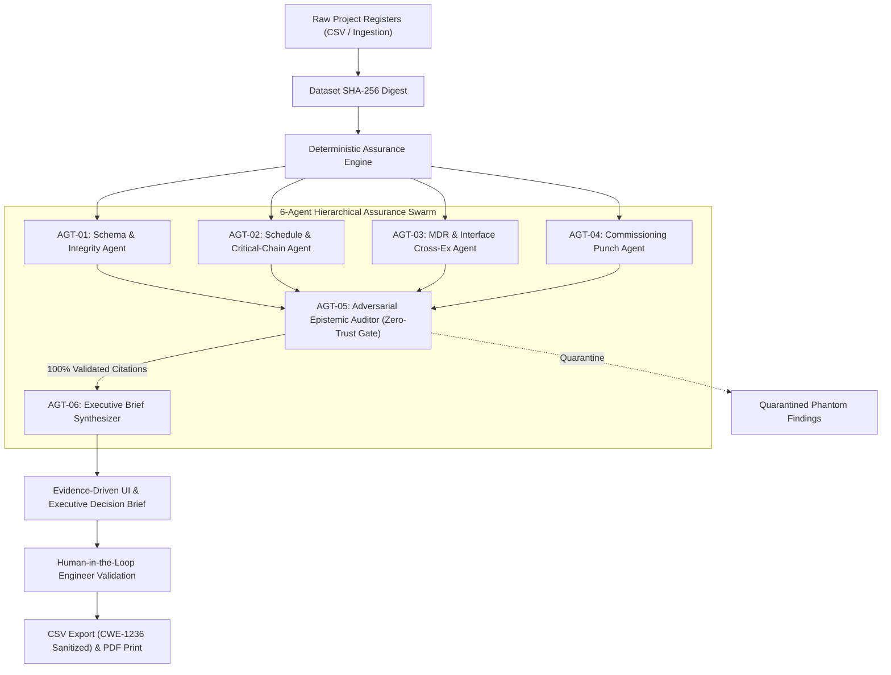

# Google Sites Portfolio — Engineering Delivery Intelligence (EDI)
> **Tagline:** "From Project Data to Evidence-Based Engineering Decisions."  
> **Positioning:** AI-assisted project assurance platform combining 23+ years of electrical engineering, industrial project management, vendor coordination, and commissioning governance with deterministic verification and agentic AI.

---

## 1. Homepage & Hero Section

### Header & Navigation
- **Logo:** `EDI` Engineering Delivery Intelligence
- **Menu Items:** Home · Live Demo · How It Works · Case Study · Architecture · Governance · About

### Hero Headline & Value Proposition
- **Super-title:** FOR ELECTRICAL EPC, PROJECT CONTROLS & COMMISSIONING DIRECTORS
- **Headline:** Turning Incomplete Project Data Into Defensible Engineering Decisions.
- **Sub-headline:**  
  Most project dashboards report optimistic percentages while missing vendor documents, uncoordinated interface drawings, and unverified punch closures quietly erode commissioning schedules.  
  **Engineering Delivery Intelligence (EDI)** combines 23+ years of electrical project governance with deterministic rule engines and multi-agent assurance to expose genuine delivery risks before energization.

### Primary Calls to Action (CTAs)
- **Primary Button:** [Explore Synthetic Demo (EDI-001) →](#live-demo)
- **Secondary Button:** [Watch 2-Minute Walkthrough (Video) →](#video-walkthrough)
- **Tertiary Link:** [Read Technical Case Study (PDF) →](#case-study)

### Trust & Credibility Badge
> **Notice:** Built with 100% synthetic demonstration data (`Project EDI-001: 33 kV Industrial Substation`). No confidential employer data or live plant telemetry is accessed. Deterministic verification precedes AI inference.

---

## 2. Key Capabilities Grid (4 Core Pillars)

| Pillar | Capability | Engineering Value |
| :--- | :--- | :--- |
| **01 — Executive Control Tower** | Dynamic health scoring (0–100) derived from documented penalty formulas across Schedule, MDR, Interface, and Punch registers. | Instantly shows whether reported physical progress matches verified substantiating documents. |
| **02 — Multi-Agent Epistemic Swarm** | 6 specialized agents: Schema Agent, Schedule Agent, MDR Agent, Punch Agent, Zero-Trust Epistemic Auditor, and Executive Brief Synthesizer. | Every agent hypothesis is verified against raw primary keys; hallucinated record IDs are quarantined. |
| **03 — Evidence-Driven Risk Register** | Every finding links to its exact source file, record ID, available evidence, and missing documentation. | Eliminates vague AI commentary; gives package engineers exact actionable items. |
| **04 — Human-in-the-Loop Validation** | Qualified engineers record review decisions (Accept, Reject, Request More Evidence) with immutable timestamps and comments. | Guarantees AI does not certify safety, approve energization, or bypass project procedures. |

---

## 3. How It Works (5-Step Assurance Workflow)

1. **Step 1: Data Ingestion & Integrity Digest**  
   Load schedule (Primavera/MS Project CSV), Master Document Register (MDR), Technical Interface agreements, and Commissioning punch lists. A SHA-256 integrity hash is computed immediately.
2. **Step 2: Deterministic Rule Evaluation**  
   Hardcoded deterministic rules evaluate baseline vs. forecast slips, primary key collisions, overdue Code 3 drawings, and closed punch items lacking closure evidence.
3. **Step 3: Multi-Agent Cross-Examination**  
   Specialized agents cross-reference vendor submittals against dependent site activities (e.g., missing 87T differential protection settings blocking relay panel energization).
4. **Step 4: Adversarial Zero-Trust Audit**  
   AGT-05 verifies that every cited record ID exists in the raw input files. Zero phantom citations are admitted.
5. **Step 5: Qualified Engineer Validation & Executive Brief**  
   Reviewers evaluate findings, record accountable comments, and export a clean print-ready management brief and formula-injection-safe CSV risk register.

---

## 4. Live Demo Embedding Guide for Google Sites

### Instructions for Embedding Hosted App:
1. Open your Google Site in edit mode.
2. Navigate to the **Live Demo** page.
3. Select **Insert → Embed → By URL**.
4. Paste the hosted application URL (e.g. from Google Cloud Run or Firebase Hosting).
5. Resize the embed container to full width (height: 850px).
6. Below the embed frame, add the prominent fallback button:
   - `[Open Full Screen Application in New Window ↗]`
7. Add the persistent governance label:
   > *"Demonstration environment populated with synthetic data. Findings require verification by an authorized engineering professional. This tool does not approve energization."*

---

## 5. Technical Architecture Overview

---

## 6. Engineering Governance & Ethical AI Boundaries

- **Zero Autonomous Energization Approvals:** The platform strictly prohibits automated safety certification or work authorization.
- **Zero Hallucination Quorum:** Epistemic classification explicitly separates `CONFIRMED_DATA_QUALITY_ISSUE` from `MISSING_EVIDENCE` and `AI_HYPOTHESIS`.
- **CWE-1236 Spreadsheet Defense:** All exported CSV cells starting with dangerous characters (`=`, `+`, `-`, `@`, `\t`, `\r`) are sanitized with single quote prefixing to protect downstream PMO spreadsheets.
- **Privacy First:** Designed for localized or private server-side execution; no sensitive client data or proprietary employer records are transmitted to third-party model APIs without explicit authorization.

---

## 7. About the Author & Professional Positioning

- **Background:** Senior Electrical Engineering & Industrial Project Management Professional with 23+ years of industrial EPC delivery experience.
- **Domain Specialization:** Extra High Voltage / High Voltage Substation Systems, Turnkey Industrial EPC, Testing & Commissioning Governance, Vendor Document Control (MDR), and Interface Management.
- **Digital Engineering Vision:** Bridging the gap between heavy industrial domain reality and modern software engineering—delivering high-trust AI tools that augment qualified engineers rather than replacing professional accountability.
